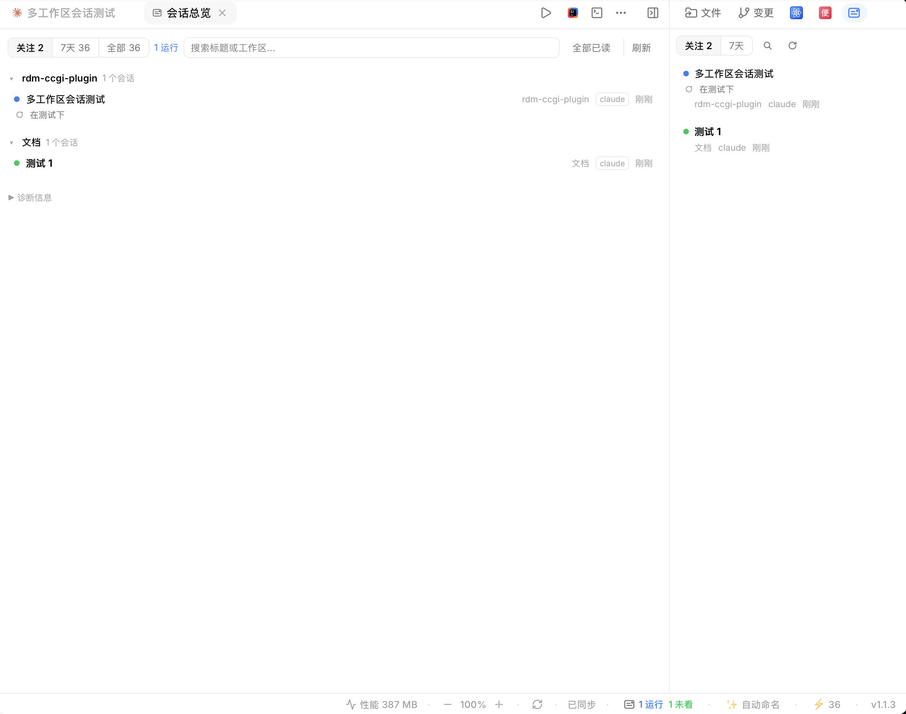

# 会话总览（Session Overview）

一个 CC GUI 插件：**跨项目统一查看所有会话状态**，一眼看清哪些对话需要你处理、哪些正在运行、哪些完成了还没看，点击直达对应对话。

## 解决什么问题

同时并行多个项目、多个会话时，完成或等待确认的会话散落在各个工作区分组里，得挨个点进去翻。本插件把它们汇到一处：

- **需确认**（橙点）：会话在等你授权工具执行——最需要先处理
- **进行中**（蓝点脉动）：正在跑
- **未查看**（绿点 + 加粗标题）：对话已结束，你还没回去看结果
- **已完成**（灰点）：已读的空闲会话，默认折叠出关注列表

## 入口

| 入口 | 说明 |
| --- | --- |
| 中央标签页 | 宽视图，按工作区分组、可折叠，带诊断信息 |
| 右侧面板 | 窄栏紧凑卡片，随聊天页常驻 |
| 侧边栏导航 | 主页侧栏「自动化」下方一键打开 |
| 状态栏 chip | 常驻底部，显示「N 运行 / N 未看」，点击打开 |
| 命令面板 | 搜「会话总览」直达 |

## 功能

- **关注列表**：默认只显示 需确认 / 进行中 / 未查看，按紧急度排序（需确认 > 进行中 > 未查看），混排不分组；可切换「近 7 天」「全部」
- **最后问答预览**：每个会话显示最后一问一答（各 2 行自动换行），进行中的会话只显示最后一问，不用点进去就知道聊到哪了
- **实时状态**：每 5 秒直接读取转录文件更新状态（不依赖宿主扫描快照，对话结束几秒内即翻转）；检测到宿主目录落后时自动触发宿主重扫（限频 45 秒）
- **点击跳转**：点任意会话直达对应对话并标记已读；也可单个标已读或「全部已读」
- **搜索引擎**：按标题 / 工作区名过滤
- **双引擎**：同时支持 Claude Code 与 Codex 的会话

## 安装

在 CC GUI 的 插件 → 添加 中，导入本目录（或打包后的 zip）。插件为单文件 JS（Tier-1），无外部依赖，仅要求本机有 `python3`。

### 权限说明

| 权限 | 用途 |
| --- | --- |
| `ui:center-tab` / `ui:panel-tab` / `ui:sidebar-entry` / `ui:status-bar` / `ui:command` | 五个入口界面 |
| `theme` | 使用宿主主题色，深浅色自适应 |
| `host:session` | 跳转到会话、请求刷新会话目录 |
| `exec:python3` | 运行内嵌只读扫描脚本 |
| `storage` | 记住已读状态 |
| `session.lifecycle.read` / `runtime.events.read` / `runtime.switch.observe` / `prompt.contribute.internal` | 会话生命周期与事件探针（为后续宿主事件驱动状态做准备） |

扫描脚本以只读方式打开宿主数据库（`~/.ccgui-next/app.db`，`mode=ro`），只读转录文件末尾 96KB 判断状态，不写任何宿主数据。

## 已知限制

- 长时间执行的工具（>60 秒）暂无法与「等待权限确认」区分，可能短暂显示为需确认
- 远程工作区（ssh / WSL）的会话依赖宿主数据库快照，状态实时性以宿主同步为准

## 版本

- **0.1.2** 列表右键菜单：固定 / 解除固定（固定的会话始终显示在关注列表，带图钉标记）、标为已读、打开会话
- **0.1.1** 补齐 manifest 必填字段（repo / license / minAppVersion）
- **0.1.0** 首个公开发布：关注列表（需确认 / 进行中 / 未查看）、中央页签 + 右侧面板双入口、最后问答预览、实时状态（直读转录文件 mtime，快照落后时自动触发宿主重扫）、搜索、状态栏 chip、命令面板，支持 Claude Code 与 Codex 双引擎

## License

MIT
